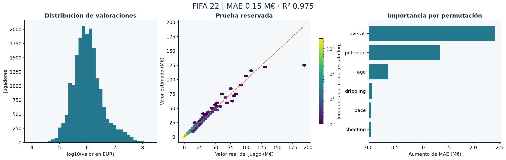

# FIFA 22: estimación de la valoración de jugadores

**Autor:** Hector Americo Torres Huamani · [Repositorio](https://github.com/hectortorres26/fifa22-analisis-jugadores) · [Cuaderno ejecutado](analisis_jugadores_fifa22.ipynb)

Estimar `value_eur`, la valoración asignada a los jugadores dentro de FIFA 22, a partir de doce atributos deportivos y físicos. El alcance es la estructura de valoración del videojuego; no el salario (`wage_eur`) ni el precio de un traspaso real.



## Resultados verificados

| Métrica en prueba (3.833 jugadores) | Gradient boosting | Referencia por mediana |
|---|---:|---:|
| MAE | 152.336 EUR | 2.337.478 EUR |
| RMSE | 1.259.772 EUR | 8.131.754 EUR |
| R² | 0,9747 | −0,0557 |

Reducción del MAE frente a la referencia: **93,48 %**. MAE de validación cruzada: **148.460 EUR** (desviación entre particiones: 23.816 EUR). Intervalo bootstrap del 95 % del MAE de prueba: **120.983–194.366 EUR**.

El modelo reproduce bien la estructura de valoración del juego. La diferencia entre RMSE y MAE muestra errores grandes en algunos jugadores: para los 100 jugadores de prueba valorados en más de 20 millones de EUR, el MAE es de 2,93 millones. `overall`, `potential` y `age` destacan en la importancia por permutación, consistente con una valoración del videojuego fuertemente vinculada a esos atributos. Esto no demuestra capacidad para valorar fichajes reales.

Las cifras proceden de [reports/metrics.json](reports/metrics.json). El cuaderno regenera tablas y figuras desde los datos; no introduce métricas manualmente en el código.

## Herramientas y metodología

Python, pandas, NumPy y Matplotlib, con pruebas `unittest` y cuadernos ejecutados mediante nbclient. Scikit-learn aporta los pipelines, los modelos y la validación.

1. Validar unicidad de `sofifa_id`, esquema y valores numéricos. De 19.239 filas, excluir 74 sin valoración válida y positiva; nunca imputar la variable objetivo. Quedan 19.165 jugadores.
2. Utilizar doce atributos predefinidos; excluir identificadores, nombres, salario, cláusula de rescisión y la propia valoración de los predictores.
3. Reservar el 20 % como prueba aleatoria con semilla 42. Ajustar imputación por mediana e indicadores de ausencia dentro de cada partición.
4. Comparar referencia por mediana, Ridge con escalado y gradient boosting de histogramas. Los dos modelos entrenan sobre `log1p(value_eur)` y devuelven predicciones en EUR con `expm1`.
5. Seleccionar por MAE en EUR mediante cinco particiones del entrenamiento. Evaluar una vez el modelo seleccionado y la referencia en prueba.
6. Describir errores por rango de valor e importancia por permutación (cinco repeticiones) como diagnóstico posterior; no reutilizar ese diagnóstico para seleccionar variables. Calcular un intervalo de MAE con 500 remuestreos de los errores de prueba.

## Datos y procedencia

[FIFA 22 Complete Player Dataset, publicado por Stefano Leone en Kaggle](https://www.kaggle.com/datasets/stefanoleone992/fifa-22-complete-player-dataset). Descarga `players_22.csv` y colócalo en `data/`. Se usa exclusivamente el archivo de jugadores de FIFA 22; no se mezclan otras ediciones.

Los resultados publicados se ejecutaron con copias públicas descargadas de las fuentes indicadas. No se ha verificado identidad byte a byte con los archivos del Drive del autor. Las huellas SHA-256 en [data/README.md](data/README.md) y `reports/metrics.json` identifican las entradas exactas. Los datasets se excluyen de Git; consulta las condiciones de cada fuente antes de reutilizarlos o redistribuirlos.

| Campo | Uso |
|---|---|
| `value_eur` | Objetivo, valoración del videojuego en EUR |
| `sofifa_id` | Control de unicidad; excluido del modelo |
| `age`, `height_cm`, `weight_kg` | Atributos físicos y edad |
| `overall`, `potential`, `international_reputation` | Valoraciones generales del juego |
| `pace`, `shooting`, `passing`, `dribbling`, `defending`, `physic` | Habilidades de campo; permiten nulos que se imputan en entrenamiento |
| `wage_eur`, `release_clause_eur` | Excluidos; pueden actuar como aproximaciones del objetivo |

## Reproducir el proyecto

```powershell
git clone https://github.com/hectortorres26/fifa22-analisis-jugadores.git
cd fifa22-analisis-jugadores
python -m venv .venv
.\.venv\Scripts\python.exe -m pip install -r requirements.txt
# Coloca los archivos descritos en «Datos y procedencia» dentro de data/.
.\.venv\Scripts\python.exe -m unittest discover -s tests -v
.\.venv\Scripts\python.exe -m src.analysis
.\.venv\Scripts\python.exe scripts/execute_notebook.py
```

En macOS/Linux utiliza `.venv/bin/python` en lugar de `.\.venv\Scripts\python.exe`.
La ejecución validada utiliza Python 3.11.9; las versiones están fijadas en `requirements.txt`.
`python -m src.analysis --help` permite cambiar rutas de entrada y salida.
El último comando ejecuta el cuaderno en un kernel nuevo y guarda sus salidas; no requiere instalar la interfaz de Jupyter.
Para explorarlo interactivamente, abre el archivo `.ipynb` en VS Code con soporte de Jupyter y selecciona el entorno `.venv`.


## Estructura

| Ruta | Contenido |
|---|---|
| `analisis_jugadores_fifa22.ipynb` | Problema, metodología, ejecución y conclusiones |
| `src/analysis.py` | Validación, análisis y generación de resultados |
| `src/common.py` | Estilo visual, serialización y trazabilidad |
| `tests/test_analysis.py` | Regresiones de los fallos técnicos corregidos |
| `data/README.md` | Entradas requeridas y huellas SHA-256 |
| `reports/` | Métricas JSON, tablas agregadas CSV y figuras PNG |
| `scripts/execute_notebook.py` | Ejecución reproducible con kernel limpio |
| `DESCRIPCION_PORTAFOLIO.md` | Texto profesional listo para el portafolio |

## Alcance y limitaciones

La validación aleatoria dentro de una misma edición no prueba generalización temporal a otras ediciones ni al mercado real. Las valoraciones pueden derivarse de reglas internas asociadas a los propios atributos, lo que facilita predicciones altas. Las seis habilidades de campo tienen 2.124 valores ausentes cada una en las filas retenidas; la imputación con indicadores no sustituye un estudio específico de porteros. La importancia por permutación depende de correlaciones entre atributos y no representa causalidad. El intervalo bootstrap mantiene fijo el modelo y no incorpora incertidumbre del entrenamiento. El modelo se entrena con pérdida sobre el objetivo logarítmico, aunque se selecciona y evalúa por error en EUR.

## Historial y correcciones

El [archivo de la versión inicial](https://github.com/hectortorres26/fifa22-analisis-jugadores/blob/420ad20f5aabeab2901a1270194053a5af660570/analisis_jugadores_fifa22.ipynb) permanece en el historial.
Los cambios se registran en commits separados para código, cuaderno/resultados y documentación, sin reescribir la versión inicial.
Consulta [CHANGELOG.md](CHANGELOG.md) para relacionar los problemas originales con las correcciones.

Referencia metodológica: [prevención de fuga de información en scikit-learn](https://scikit-learn.org/stable/common_pitfalls.html).
